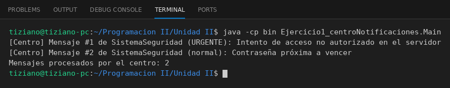

# CentroMensajeria

Programación II - Unidad 2 - Ejercicio 1

## Consigna
Un objeto emisor (SistemaSeguridad) le envía mensajes a un objeto receptor (CentroMensajeria) pasando un objeto Mensaje como parámetro.

## Lógica
- `Mensaje`: encapsula `remitente`, `texto` y `prioridad` (1 a 3, validada en el constructor).
- `CentroMensajeria.recibirMensaje(Mensaje m)`: guarda el mensaje en una lista y lo muestra, marcándolo como URGENTE si la prioridad es 3.
- `SistemaSeguridad`: guarda una referencia al centro; `enviarAlerta(texto, prioridad)` arma un `Mensaje` y se lo manda al centro (la colaboración entre objetos).
- `Main`: envía dos alertas de distinta prioridad e imprime cuántos mensajes procesó el centro.

## Ejecución

